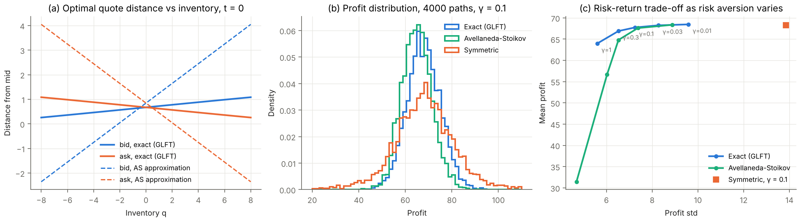
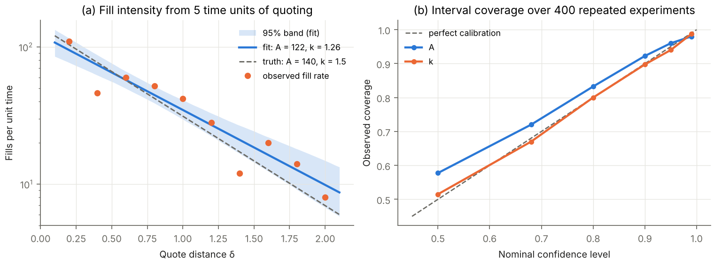
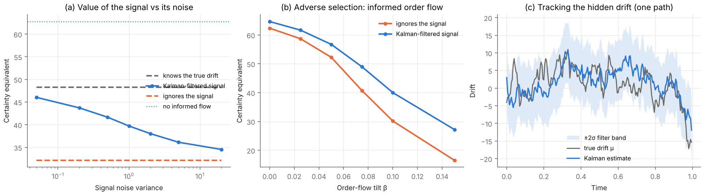

# MM Lab: market making under inventory risk

What is the optimal way to quote a bid and an ask when every fill changes your inventory risk, and how much is a short-term price signal worth when some of your counterparties are better informed than you?

This project treats market making as a stochastic control and estimation problem. It reproduces the classic Avellaneda–Stoikov results, solves the same problem exactly, calibrates the fill model from data with confidence intervals that are checked for honest coverage, and measures the value of a noisy price signal under adverse selection. Everything runs on simulated markets with known ground truth, so each method can be checked against the answer it should find.



## Results

**1. Reproduces the original paper.** With the parameters of Avellaneda & Stoikov (2008), section 4 (s0 = 100, σ = 2, T = 1, A = 140, k = 1.5, γ = 0.1, dt = 0.005), 4000 simulated paths give:

| Strategy | Mean profit ± std | Final inventory std | Paper (Table 1) |
|---|---|---|---|
| Avellaneda–Stoikov (inventory) | 65.0 ± 6.5 | 2.85 | 62.9 ± 5.9, q std 2.80 |
| Symmetric (same spread around the mid) | 68.2 ± 13.9 | 8.51 | 67.2 ± 13.4, q std 8.66 |

**2. The exact solution beats the textbook approximation.** With exponential fill intensities and an inventory limit, the Hamilton–Jacobi–Bellman equation reduces to a *linear* ODE system, solved here by eigendecomposition of a tridiagonal matrix (Guéant, Lehalle & Fernandez-Tapia, 2013). Measured by the certainty equivalent CE = −(1/γ) ln E[exp(−γ · profit)], the objective the market maker actually optimises:

| Strategy | Certainty equivalent (± bootstrap s.e.) |
|---|---|
| Exact (GLFT) | 65.4 ± 0.1 |
| Avellaneda–Stoikov approximation | 62.9 ± 0.1 |
| Symmetric | 43.7 ± 7.6 |

The approximation skews quotes far too aggressively with inventory early in the day (figure 1a), giving up spread income to control risk it would have controlled anyway. Across risk aversions the exact strategy dominates the approximation on the mean–std plane (figure 1c).

**3. Calibrated with honest uncertainty.** A market maker never sees A and k; it sees how often its quotes get filled. A Poisson maximum-likelihood fit with Fisher-information confidence intervals recovers them, and over 400 repeated experiments the nominal 95% intervals contain the truth 96% (A) and 94% (k) of the time, close to nominal at every confidence level (figure 2b).



**4. A noisy signal is worth a lot, but less than perfect information.** The drift of the price follows an Ornstein–Uhlenbeck process and also tilts order flow (informed buyers arrive when the price is about to rise). The market maker sees only a noisy observation, filters it with a Kalman filter, and shifts its reservation price by the expected move over the remaining horizon.

- Informed flow (β = 0.1) cuts the certainty equivalent from 62.8 to 32.2 for a market maker that ignores the signal.
- The filtered signal recovers it to 39.7; knowing the true drift would give 48.3.
- The gap to perfect information narrows as the signal gets cleaner (figure 3a), and the advantage of using the signal grows with the strength of the adverse selection (figure 3b).



## Model

| Component | Model |
|---|---|
| Mid price | dS = μ dt + σ dW (μ = 0 except in the signal study) |
| Fills | quote at distance δ filled with intensity A e^(−kδ) per unit time |
| Objective | maximise E[−exp(−γ (cash + q S_T))] |
| AS approximation | reservation price r = s − qγσ²(T−t), spread γσ²(T−t) + (2/γ) ln(1+γ/k) |
| Exact solution | θ = (1/k) ln w, dw/dt = αq²w − η(w_{q+1} + w_{q−1}), α = kγσ²/2, η = A(1+γ/k)^−(1+k/γ) |
| Drift signal | dμ = −κμ dt + ν dB; order flow scaled by (1 ± βμ); observation z = μ + noise; Kalman filter |

## Validation

`pytest` runs 13 tests (about 3 s):

- **Exact solution:** terminal quotes equal the myopic half-spread; the matrix-exponential solution matches a direct numerical integration of the nonlinear HJB equation to 1e-6; quotes are symmetric in inventory; a long position lowers both quotes; the inventory limit is never breached.
- **Simulation:** fill rates match A e^(−kδ); the Avellaneda–Stoikov table is reproduced within stated tolerances; the exact strategy has a higher certainty equivalent than the approximation by more than three standard errors.
- **Calibration:** the MLE recovers the parameters; 95% intervals have 92–98% coverage over 500 experiments; interval width shrinks as 1/√(data).
- **Filtering:** the Kalman filter's actual error variance matches the variance it reports; with drift, oracle > Kalman > ignoring the signal.

## Run it

```bash
pip install -e ".[dev]"
pytest
python examples/make_figures.py   # figures/ and a numeric summary (~3 min)
```

## Limitations

- **Simulated markets only.** Fills follow the model's own Poisson intensity, so results show that the methods work when the model is right, not that the model describes a real order book. The next step would be calibrating on real limit-order-book data, where queue position, tick size, latency and fees all matter.
- **Single asset, continuous prices.** No tick grid, no queue priority, no hedging with correlated instruments (central to ETF market making).
- **Signal model.** The drift is a stylised hidden state with a Gaussian observation; real short-term signals are weaker, non-stationary, and have to be found before they can be filtered.
- **Discrete time.** Fills use a Bernoulli approximation with probability λ dt; with A dt = 0.7 the per-step fill probability stays below 0.7 for any quote at or outside the mid, but quotes inside the mid (possible with a large inventory skew) are capped at probability 1, and a finer step would be needed to model them accurately.

## References

- M. Avellaneda, S. Stoikov, "High-frequency trading in a limit order book", *Quantitative Finance* 8(3), 2008.
- O. Guéant, C.-A. Lehalle, J. Fernandez-Tapia, "Dealing with the inventory risk: a solution to the market making problem", *Mathematics and Financial Economics* 7, 2013.
- O. Guéant, *The Financial Mathematics of Market Liquidity*, CRC Press, 2016.
